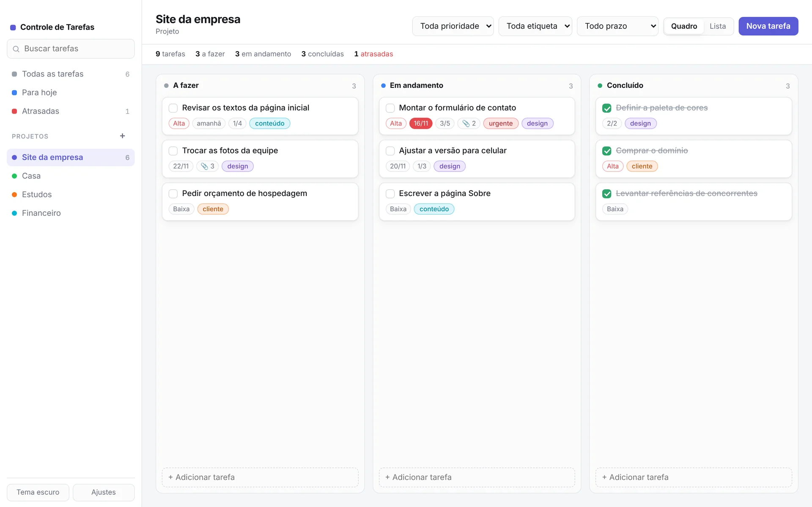

<div align="center">


# Controle de Tarefas · site

**Página de divulgação e download do Controle de Tarefas**, um gerenciador de
projetos e tarefas que roda no próprio computador — sem nuvem, sem conta e sem mensalidade.

[](https://vuejs.org)
[](https://vite.dev)
[](https://guilhermemigliano.github.io/Tasks-Web/)
[](LICENSE)

[**Ver o site**](https://guilhermemigliano.github.io/Tasks-Web/)



</div>

---

## O produto

O **Controle de Tarefas** é um aplicativo de desktop para Windows e macOS. A ideia é
simples: organizar o que precisa ser feito sem depender de internet, de assinatura ou de
mais uma conta para criar.

| | |
|---|---|
| **Projetos separados** | Cada frente de trabalho com suas próprias tarefas, cores e etiquetas |
| **Quadro Kanban** | Arrastar e soltar entre *A fazer*, *Em andamento* e *Concluído* |
| **Prazos e prioridades** | Destaque para o que vence hoje e para o que passou do prazo |
| **Etiquetas por projeto** | Coloridas, criadas na hora, com filtro em um clique |
| **Anexos** | Arraste arquivos para dentro da tarefa; imagens ganham miniatura |
| **100% local** | Banco SQLite na sua máquina, funciona offline |

O código do aplicativo fica em repositório privado. Este repositório contém **apenas o site**.

## Este repositório

Site estático de uma página, feito em Vue 3 com Vite. Sem framework de CSS e sem
dependências além do próprio Vue: a folha de estilos é escrita à mão, as animações de
entrada usam `IntersectionObserver` através de uma diretiva (`v-revelar`) e as capturas
de tela são imagens reais do aplicativo em execução.

### Como rodar

Requer [Node.js](https://nodejs.org) 18 ou superior.

```bash
npm install
npm run dev       # servidor local em http://localhost:5173
npm run build     # gera a pasta dist/
npm run preview   # serve a pasta dist/ para conferência
```

### Estrutura

```
src/
├── componentes/   seções da página (topo, capa, recursos, telas, download, perguntas, rodapé)
├── dados/         textos e lista de downloads — é aqui que o conteúdo é editado
├── estilos/       variáveis de cor, tipografia e utilitários
└── utilitarios/   diretiva de animação e resolução de caminhos
public/
├── capturas/      imagens do aplicativo em WebP
└── ícones e imagem de compartilhamento
```

### Editar o conteúdo

Quase todo o texto vive em dois arquivos, sem precisar mexer nos componentes:

- `src/dados/recursos.js` — os seis cartões de recursos e as perguntas frequentes
- `src/dados/downloads.js` — as versões disponíveis, os nomes dos arquivos e os avisos de cada sistema

### Links de download

Os instaladores não ficam no repositório: o GitHub recusa arquivos acima de 100 MB e os
`.dmg` passam disso. Depois de hospedá-los, informe o endereço da pasta:

```js
// src/dados/downloads.js
export const BASE = 'https://exemplo.com/downloads';
```

Enquanto essa linha estiver vazia, os botões aparecem como **Em breve** em vez de levarem
o visitante a um link quebrado.

### Atualizar as capturas de tela

As imagens em `public/capturas/` são da interface real, com dados de exemplo, em
1920×1200 e formato WebP. Para trocá-las, mantenha os mesmos nomes de arquivo e a mesma
proporção — o restante do layout se ajusta sozinho.

## Publicação

A cada push na branch `main` que altere arquivos do site, o workflow
[`publicar-site.yml`](.github/workflows/publicar-site.yml) compila o projeto e publica no
GitHub Pages.

Para ligar, uma única vez: **Settings › Pages › Source: _GitHub Actions_**.

> O caminho base do Vite (`/Tasks-Web/`) acompanha o nome do repositório. Ao renomear o
> repositório, ajuste `base` em `vite.config.js`, senão o site publicado não encontra os
> próprios arquivos.

## Licença

[MIT](LICENSE) — Guilherme Migliano
