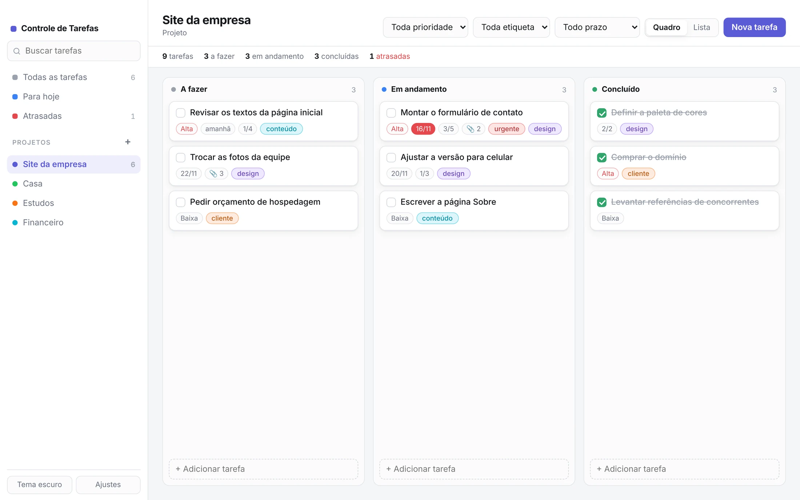
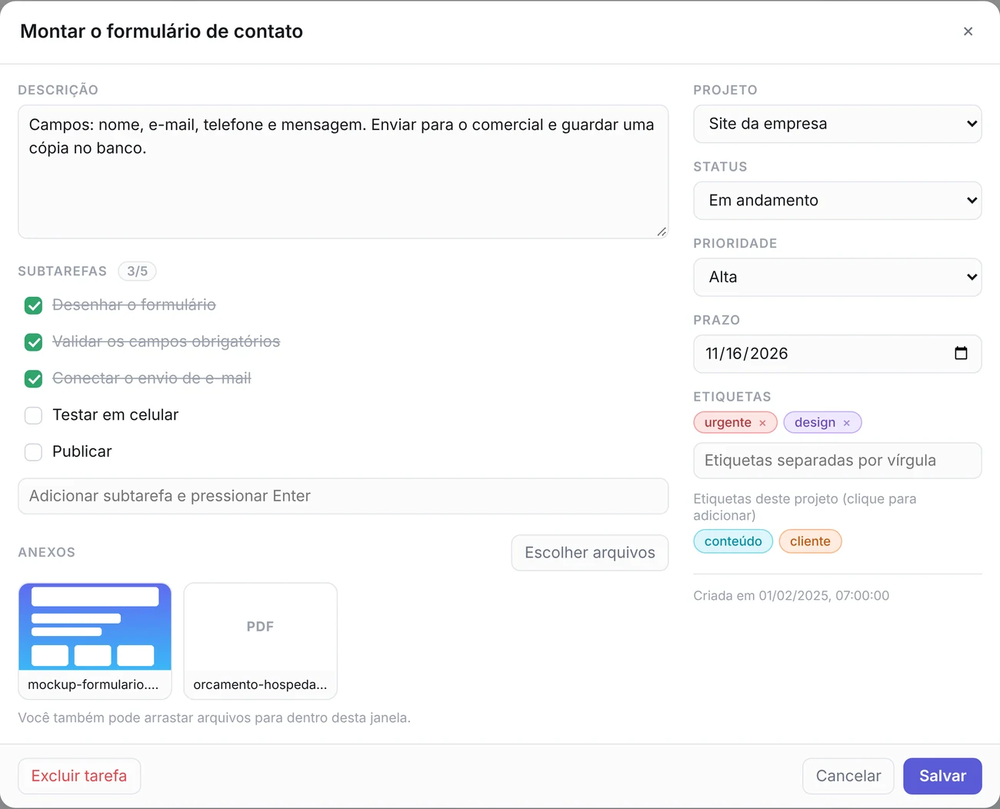
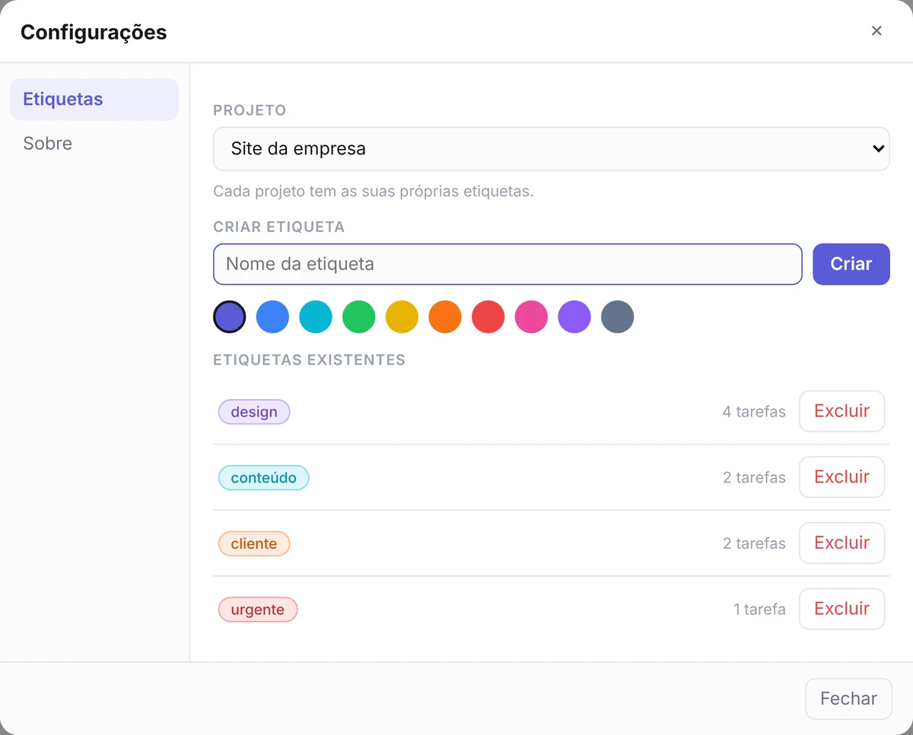
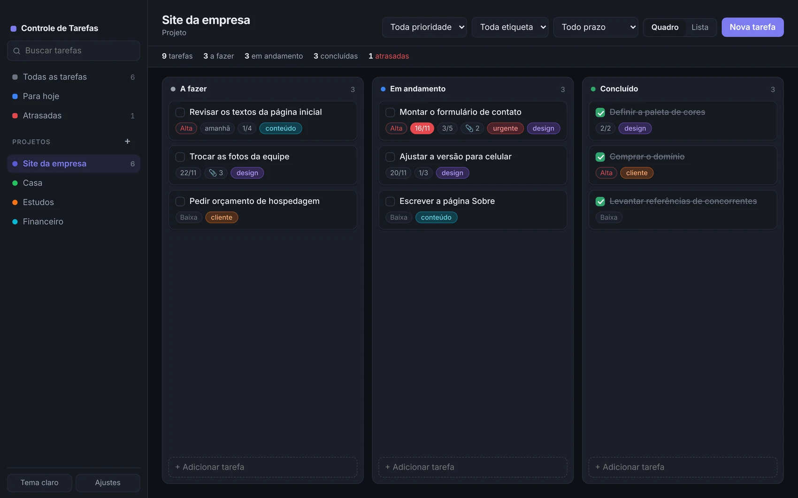

# Controle de Tarefas

### Seus projetos e tarefas organizados, no seu computador

Um gerenciador de tarefas de desktop para **Windows** e **macOS** que funciona
sem nuvem, sem conta e sem mensalidade.

**[⬇︎ Baixar o aplicativo](https://guilhermemigliano.github.io/Tasks-Web/#baixar)**

 

 

## O que é

A maioria dos gerenciadores de tarefas pede cadastro, exige internet e cobra assinatura
para liberar o que importa. O **Controle de Tarefas** faz o contrário: é um programa que
você instala, abre e usa. Os dados ficam num arquivo no seu computador, e só.

A ideia é ser o suficiente para organizar o trabalho sem virar mais uma obrigação:
projetos de um lado, tarefas do outro, um quadro para ver o andamento e nada além disso.

 

## Funcionalidades

### Um quadro para cada projeto

Separe trabalho, casa e estudos. Cada projeto tem as suas próprias tarefas, cor e
etiquetas, sem misturar nada. A barra lateral mostra quantas tarefas em aberto cada um
tem, além das visões **Todas as tarefas**, **Para hoje** e **Atrasadas**, que cruzam
todos os projetos de uma vez.

### Kanban com arrastar e soltar

Mova os cartões entre **A fazer**, **Em andamento** e **Concluído**. A ordem dentro de
cada coluna também é sua. Quem prefere ver tudo em sequência pode trocar para o modo
lista a qualquer momento.

### Tudo o que uma tarefa precisa

Descrição, prazo, prioridade, etiquetas, uma lista de subtarefas com contador de
progresso e arquivos anexados — tudo numa janela só. Os anexos podem ser arrastados para
dentro da tarefa: imagens ganham miniatura e abrem no próprio aplicativo, e os demais
formatos abrem no programa padrão do sistema.

### Prazos que aparecem

Defina data de vencimento e prioridade. O que vence hoje aparece em destaque, o que
passou do prazo fica em vermelho, e os filtros do topo permitem ver só o que interessa:
por prioridade, por etiqueta ou por prazo.

### Etiquetas por projeto

Crie etiquetas coloridas digitando vários nomes separados por vírgula, ou escolha entre
as que já existem com um clique. Cada projeto tem o seu próprio conjunto, então
*urgente* em Casa é independente de *urgente* em Trabalho. Ao excluir uma etiqueta que
está em uso, o aplicativo avisa quantas tarefas serão afetadas antes de confirmar.

### Tema claro e escuro

O aplicativo segue o tema do sistema na primeira abertura e pode ser trocado quando
quiser, por um botão na barra lateral ou pelo atalho de teclado.

### Busca e atalhos

A busca percorre título e descrição de todas as tarefas, em todos os projetos. Os
atalhos cobrem o uso do dia a dia:

| Atalho | Ação |
| --- | --- |
| `Ctrl/Cmd + N` | Nova tarefa |
| `Ctrl/Cmd + Shift + N` | Novo projeto |
| `Ctrl/Cmd + F` | Buscar |
| `Ctrl/Cmd + ,` | Configurações |
| `Ctrl/Cmd + Shift + T` | Alternar tema |

 

## Seus dados são seus

Não há servidor, conta nem sincronização: tudo é gravado num banco **SQLite** dentro da
pasta do aplicativo — `Application Support` no macOS, `AppData` no Windows — com os
anexos numa subpasta ao lado.

Para levar tudo para outro computador, basta copiar essa pasta. O menu *Arquivo* também
exporta um backup completo em JSON, legível por qualquer programa.

 

## Disponível para

| Sistema | Requisito | Formatos |
| --- | --- | --- |
| **Windows** | Windows 10 ou superior, 64 bits | Instalador e versão portátil |
| **macOS** | macOS 11 Big Sur ou superior | Apple Silicon e Intel |

**[Escolher a sua versão →](https://guilhermemigliano.github.io/Tasks-Web/#baixar)**

 

---

Este repositório hospeda o site de divulgação do aplicativo. 
© 2026 Task Manager · <a href="LICENSE">MIT</a>

